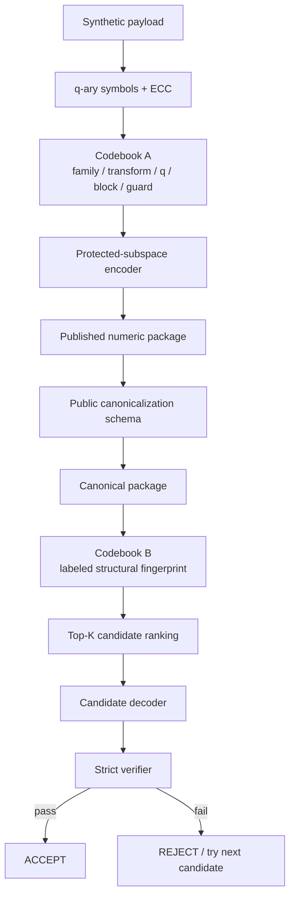

# Architecture Overview

这页只回答一个问题：

> 当前系统到底分成哪几层？



---

## Layer 1 — Numeric carrier

回答：

> 离散状态怎样进入数值数据？

核心形式：

\[
z=B(x)\beta+U(x)c
\]

其中：

- \(B\beta\)：protected macro；
- \(Uc\)：carrier freedom。

---

## Layer 2 — Codebook A

回答：

> 这张 table 应该怎样解码？

典型字段：

```text
family
transform
q
ECC
block geometry
publication guard
```

Codebook A 是 interpretation protocol。

---

## Layer 3 — Public canonicalization

回答：

> 发布过程改了顺序或单位以后，怎样回到 decoder 的规范坐标？

它处理：

```text
row reorder
column reorder
table split / merge
known unit conversion
```

这些 schema 信息是公开的，不属于 Codebook B。

---

## Layer 4 — Codebook B

回答：

> 哪些 candidate 值得优先尝试？

当前形式：

\[
F=\{(\ell_i,v_i)\}
\]

例如：

```text
label = table role
value = (family, q)
```

它只负责 locator。

---

## Layer 5 — Strict verifier

回答：

> 这个 candidate 到底是不是真的目标？

它可以检查：

```text
format
length
version
integrity tag
hash
```

所以：

\[
\text{locator hit}\neq\text{verified success}
\]

---

## 三个最容易混淆的概念

### Recognizability

别人能不能看出结构有规律。

### Interpretability

拿到正确解释规则后，能不能把结构解释成离散状态。

### Verified recovery

解码以后，最终 integrity / hash 是否通过。

三者不是一回事：

\[
\boxed{
\text{recognizability}
\neq
\text{interpretability}
\neq
\text{verified recovery}
}
\]

---

## 当前版本地图

```text
V10  package-level large round trip
V12  adaptive q
V14  dual-codebook integration
V16  labeled locator + erasure scaling
V17  publication pipeline robustness
```

下一阶段主要研究 residual model compatibility，而不是继续单纯追求更大 q。
