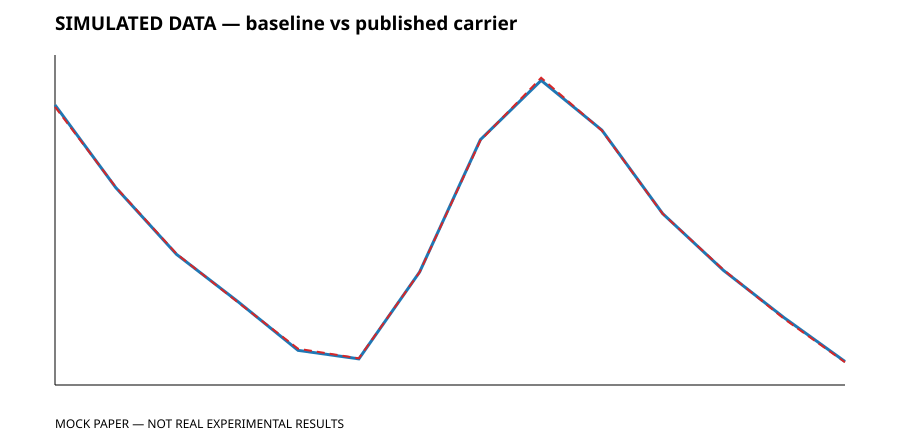
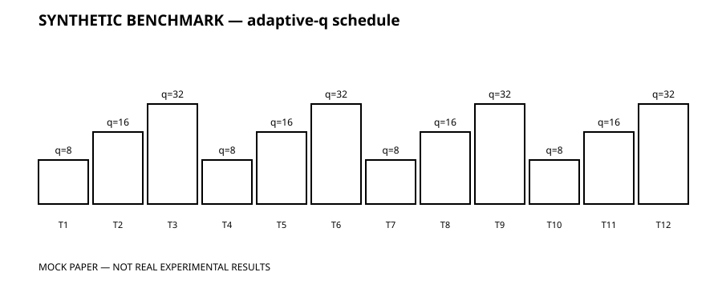
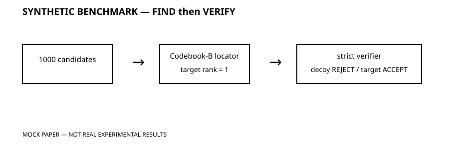

# MOCK PAPER — NOT REAL EXPERIMENTAL RESULTS

## Adaptive-Q Numeric Carrier in a Synthetic Multi-Table Package

**SYNTHETIC BENCHMARK / SIMULATED DATA ONLY**

A 8,192-byte deterministic synthetic payload was encoded
into 12 synthetic numeric tables and independently decoded from the published
package plus manifest. SHA-256 exact recovery: **TRUE**.

```text
WRITE   synthetic payload -> numeric carrier
FIND    structural fingerprint -> candidate ranking
VERIFY  strict integrity -> accept / reject
```

| table | family | q | transform |
|---:|---|---:|---|
| 1 | affine | 8 | identity |
| 2 | affine | 16 | identity |
| 3 | affine | 32 | identity |
| 4 | periodic | 8 | identity |
| 5 | periodic | 16 | identity |
| 6 | periodic | 32 | identity |
| 7 | saturation | 8 | identity |
| 8 | saturation | 16 | identity |
| 9 | saturation | 32 | identity |
| 10 | gaussian | 8 | log |
| 11 | gaussian | 16 | log |
| 12 | gaussian | 32 | log |







- candidates: **1,000**
- target rank: **1**
- best decoy: **REJECT**
- true target: **ACCEPT**
- gross bit/value: **2.286**
- payload SHA-256: `f6085d5e7a176365f8189e47e88490a33401058db8319c747cdb397fe210172e`
- decoded SHA-256: `f6085d5e7a176365f8189e47e88490a33401058db8319c747cdb397fe210172e`

All data and results are synthetic. This is not real experimental evidence.

**MOCK PAPER — NOT REAL EXPERIMENTAL RESULTS**
